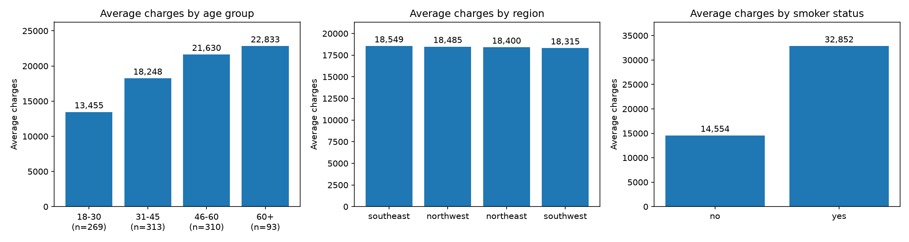

# Insurance Premium ETL and Analysis

A small ETL pipeline built with Python, Pandas, and SQLite, with SQL analysis, charts, and scheduled runs.

## Overview
Generates a synthetic insurance dataset (age, sex, BMI, children, smoker, region, charges), cleans it, loads it into a SQLite database, and analyzes average charges using SQL. Inspired by my earlier experience on a data warehouse and pricing project at TCS.

**Note:** the data is synthetic, so findings reflect how it was generated, not real-world insurance patterns.

## Pipeline
1. **Extract:** read `data/insurance.csv` (1,010 rows)
2. **Transform:**
   - removed 10 duplicate rows
   - dropped rows with missing BMI (985 rows remained)
   - standardized text (trimmed whitespace, lowercase)
   - created `age_group` and `bmi_category` columns
3. **Load:** wrote the result to the `policies` table in `insurance.db`
4. **Analyze:** SQL queries run from Python, with charts saved to `charts.png`

## Findings

- Average charges increase with age (about 13.5k for 18-30 to 22.8k for 60+).
- Smokers have much higher average charges than non-smokers.
- Regional differences were negligible.
- The 60+ group has few records (93), so its average is less reliable.

## Design decision
Missing BMI values were dropped rather than filled. Filling with the median would keep more rows but adds assumed values.

## Scheduling
The pipeline runs daily at 10:10 PM via Windows Task Scheduler (`run_pipeline.bat`), which executes `etl.py` and `analyze.py` and appends output to `pipeline.log`. Paths in the `.bat` file are specific to my machine and need adjusting elsewhere. The Linux equivalent is this cron entry:

    10 22 * * * cd /app && python etl.py && python analyze.py >> pipeline.log 2>&1

## How to run
    pip install pandas matplotlib
    python generate_data.py
    python etl.py
    python analyze.py

## Tech
Python, Pandas, SQLite, SQL, Matplotlib, Windows Task Scheduler